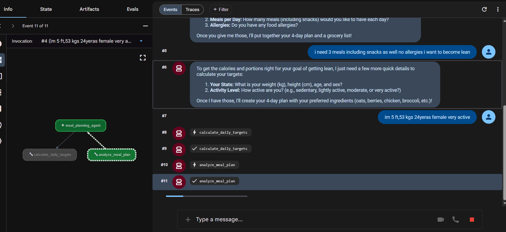

# Meal Planning Agent

An AI agent built with [Google ADK](https://google.github.io/adk-docs/) and Gemini that creates personalized meal plans (7 days by default).

## Demo

The agent gathers your details, calculates your daily targets, then checks the whole meal plan in one tool call:



## Features
- Works out daily calorie and macro targets from your body stats
- Builds multi-day meal plans with ingredients, macros and calories
- Checks every ingredient against your allergies
- Totals each day against your targets
- Generates a combined grocery list
- Falls back to another Gemini model automatically if one is rate-limited (429) or overloaded (503)

## Setup
```bash
python -m venv .venv
.venv\Scripts\activate        # Windows
# source .venv/bin/activate   # macOS / Linux
pip install -r requirements.txt
```

Copy `meal_planner/.env.example` to `meal_planner/.env` and add your Gemini API key from [Google AI Studio](https://aistudio.google.com/apikey).

## Run
```bash
adk web
```
Open the link it prints and choose `meal_planner`. Or chat in the terminal with `adk run meal_planner`.

## Example prompt
> I'm 28, female, 65 kg, 165 cm, moderately active, want to lose weight. Vegetarian, peanut allergy. Give me a 7-day meal plan with 3 meals a day and a grocery list.

*Nutrition values are estimates and not medical advice.*
